# jwDaily Hydration Log — User guide

This guide describes the **v2.0.0** interface. For version-specific changes, use [Release notes](RELEASE_NOTES.md).

## 1. Create and select a profile

Install the integration through HACS, restart Home Assistant and add it in **Settings → Devices & services**. Create one profile per person. The profile's normalized name becomes its slug, used by entities and the dashboard card (`jane_doe` in examples).

Profile settings include a daily intake target and display preferences. Independent profiles do not share recorded drinks.

<a href="images/manage-profiles.png">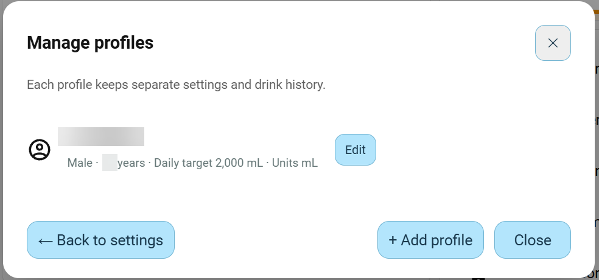</a>

<a href="images/profile-edit.png">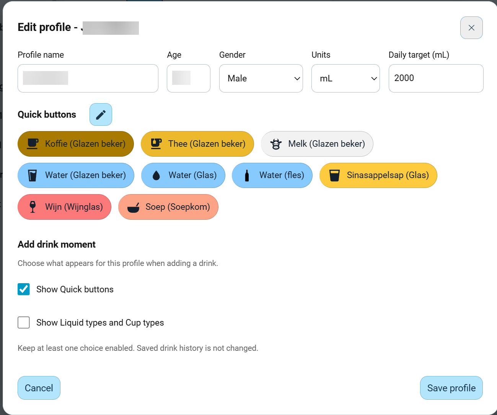</a>

## 2. Dashboard / intake card

The dashboard card shows today's intake, progress against the target, the remaining amount, recent drink history and a button for **Add drink**. You can change a historical drink's liquid, cup, volume and local date/time in the history editor. Actual recorded amounts stay with the historical event even when a Cup default changes later.

<a href="images/dashboard-main.png">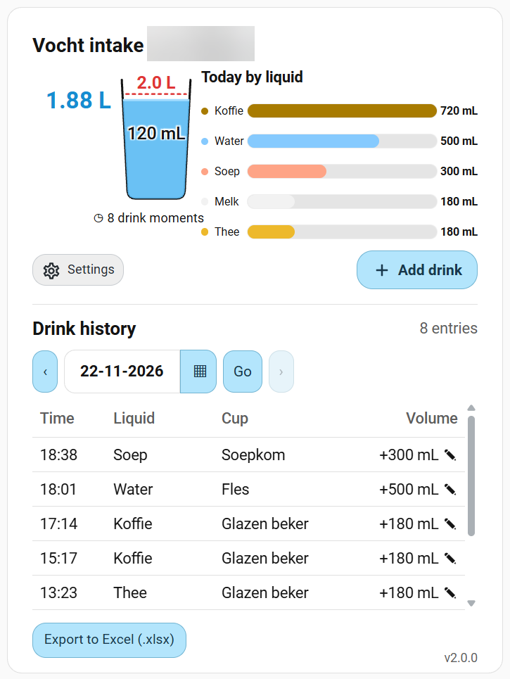</a>

## 3. Add drink

Select a **Liquid type** and **Cup type**, optionally edit the amount, date and time, and save. A **Quick button** combines a favourite Liquid/Cup pair. In **Manage profiles → Edit profile → Add drink moment**, choose whether Quick buttons, separate Liquid/Cup selectors or both are displayed. At least one of these selection methods must remain available.

**Quick buttons layout**

<a href="images/add-drink-quick-buttons.png">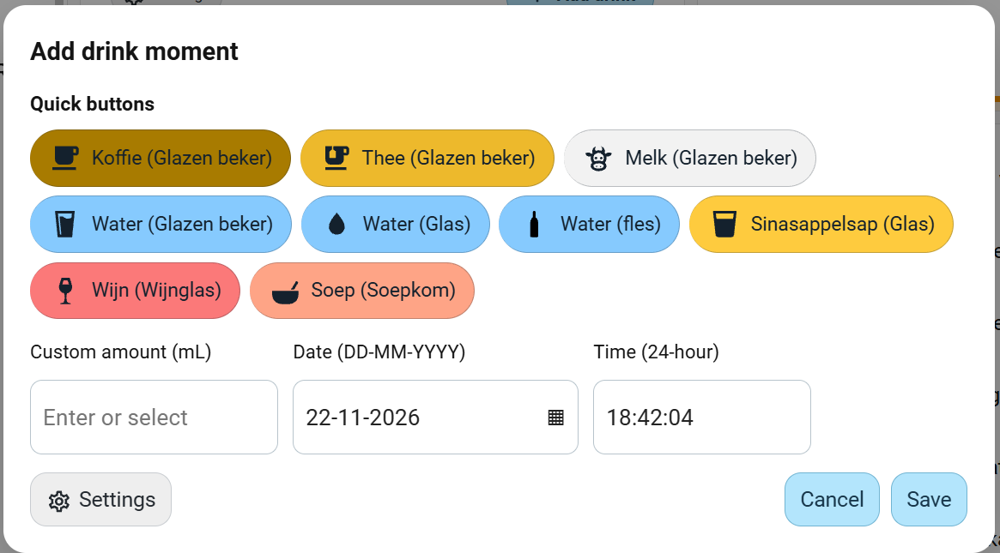</a>

**Liquid and Cup selectors layout**

<a href="images/add-drink-liquid-cup-types.png">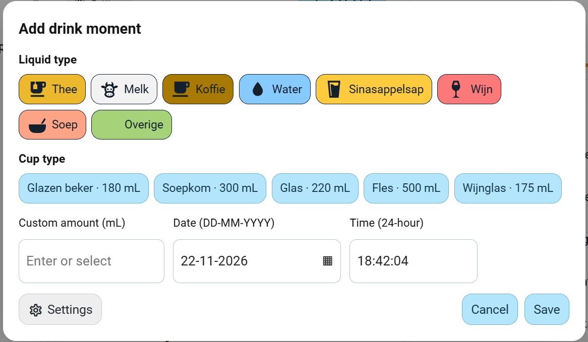</a>

## 4. Settings

Open the integration's **Settings** dialog to manage:

- **Manage profiles:** separate daily targets, age, gender, units (mL, L, fl oz) and Add drink visibility switches.
- **Liquid types:** built-in/custom liquid definitions, labels, icons, colours and display order.
- **Cup types:** cup names, default sizes, icons and visibility.
- **Quick buttons:** liquid/cup combinations, optional labels, visibility and deletion.
- **Data & Backup:** export Excel, create a full-profile backup, or preview a restore.

Use **Close** in the bottom-right footer to leave Settings.

**Settings overview**

<a href="images/settings-overview.png">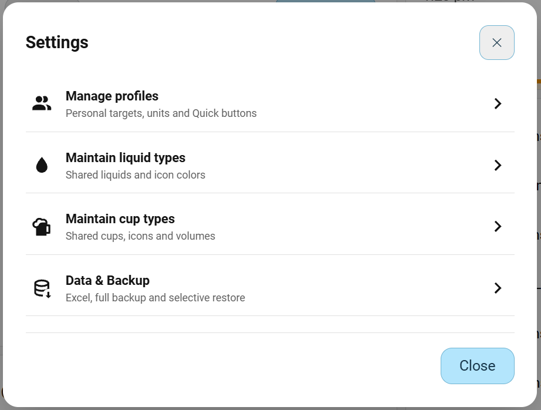</a>

**Maintain Liquid types**

<a href="images/maintain-liquid-types.png">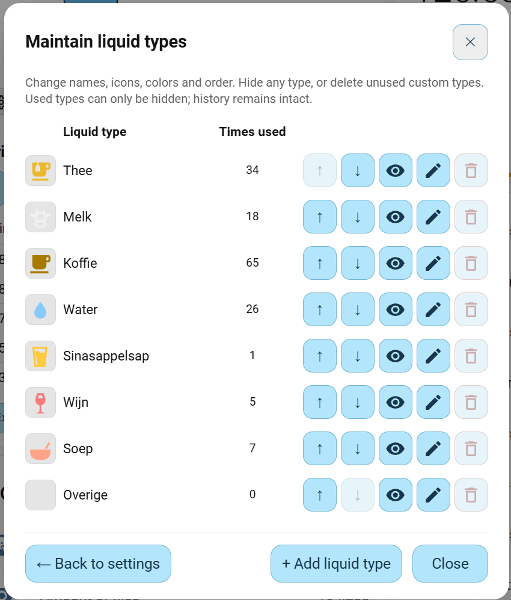</a>

**Maintain Cup types**

<a href="images/maintain-cup-types.png">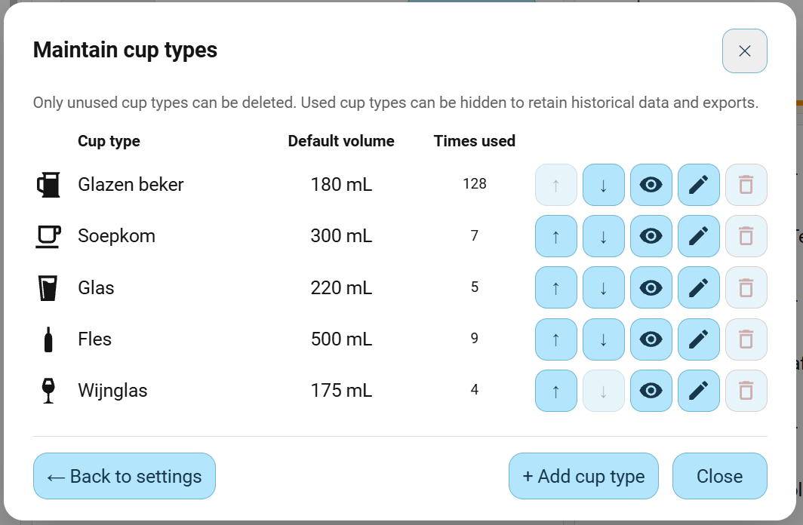</a>

**Edit Quick buttons**

<a href="images/quick-buttons-edit.png">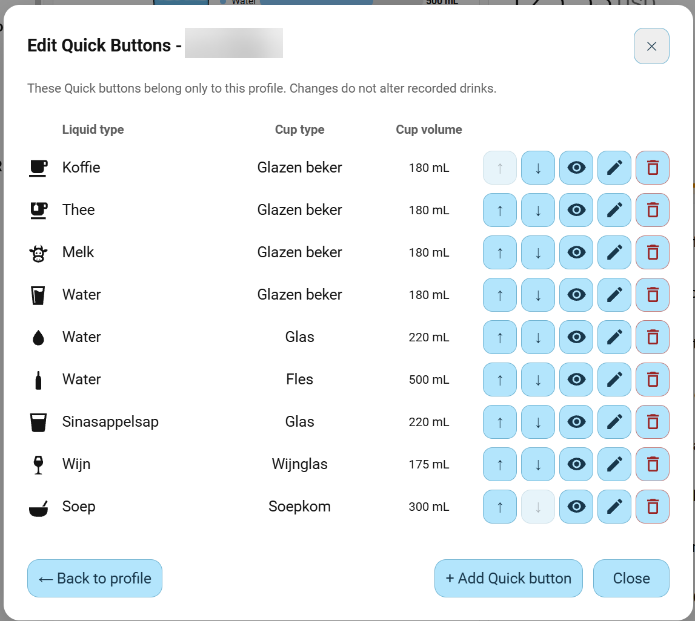</a>

## 5. Charts, sensors and snapshots

The integration publishes a 24-hour (local wall-clock) hourly data sensor and a seven-day history data sensor. Each provides structured liquid details for visualizations. Historical day snapshots preserve daily totals, including days with and without drink registrations. Optional third-party ApexCharts configuration: [example](examples/apexcharts.md).

The profile also exposes daily consumed, manual consumed, remaining, target, percentage, drink count, and an editable target number entity.

**Today by hour**

<a href="images/chart-today-by-hour.png">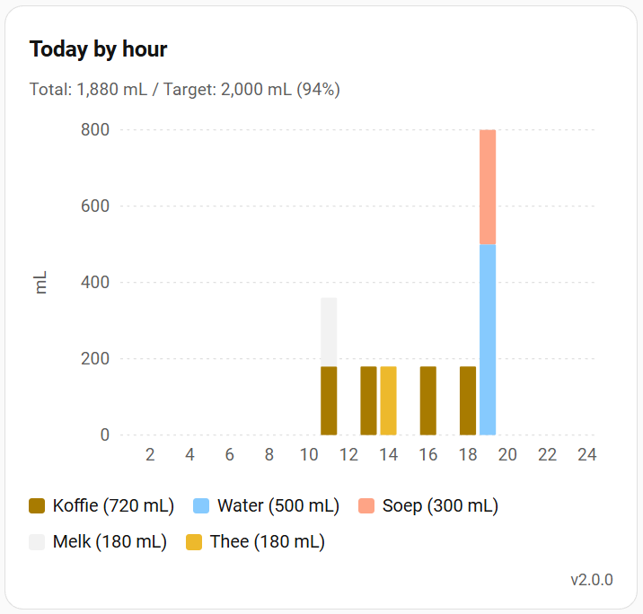</a>

**Last seven days**

<a href="images/chart-last-7-days.png">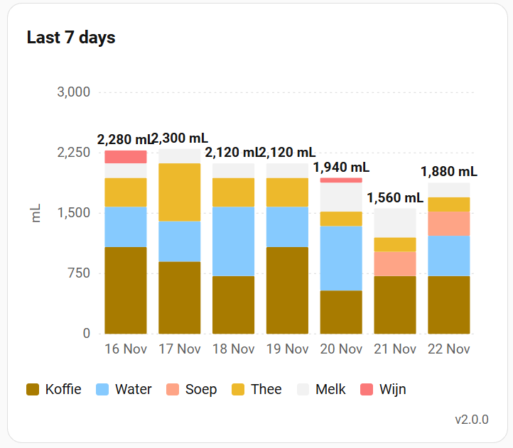</a>

## 6. Excel export

Under **Data & Backup → Export Excel**, export one profile or all profiles. The workbook has six sheets:

1. **Hydration log:** saved drink moments with historical Liquid/Cup identifiers and amounts.
2. **Daily intake:** daily totals and liquid breakdown.
3. **Settings - Liquid Types:** definitions and options.
4. **Settings - Cup types:** types, icons and volumes.
5. **Settings - Quick buttons:** configured shortcuts.
6. **Settings - Profiles:** profiles, targets, units and Add drink visibility switches.

Booleans are shown as **Yes / No**. Native Excel **Place in Cell** icon graphics require compatible desktop Microsoft Excel.

**Hydration log worksheet**

<a href="images/excel-hydration-log.png">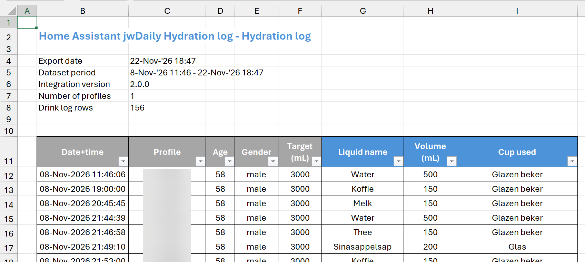</a>

**Daily intake worksheet**

<a href="images/excel-daily-totals.png">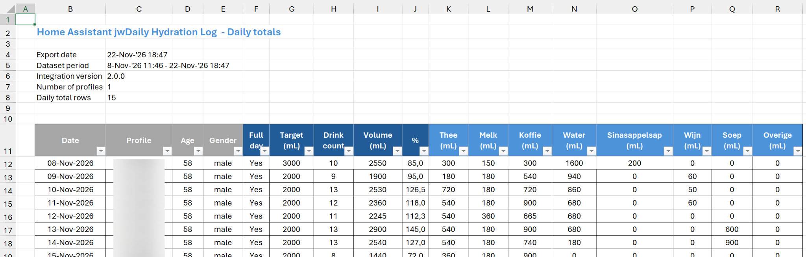</a>

## 7. Backup and Restore preview

1. Make a Home Assistant backup and download a fresh **Full Backup ZIP** from the integration.
2. Under **Data & Backup**, choose **Everything**, **Settings only** or **Data only**.
3. Use **Choose file** to load a matching profile backup ZIP, then select **Preview restore**.
4. Check the **Restore to profile** name, drink counts and full content comparison. Matching counts by themselves do not establish matching records: identity is based on validated settings and complete data hashes.
5. Only for a real restore, ensure another current recovery backup exists, acknowledge the checkbox and complete the explicit confirmation prompts.

**Previewing a backup does not restore or replace data.** ZIP validation checks its integrity and intended profile. Do not use a backup belonging to another profile.

<a href="images/data-backup.png">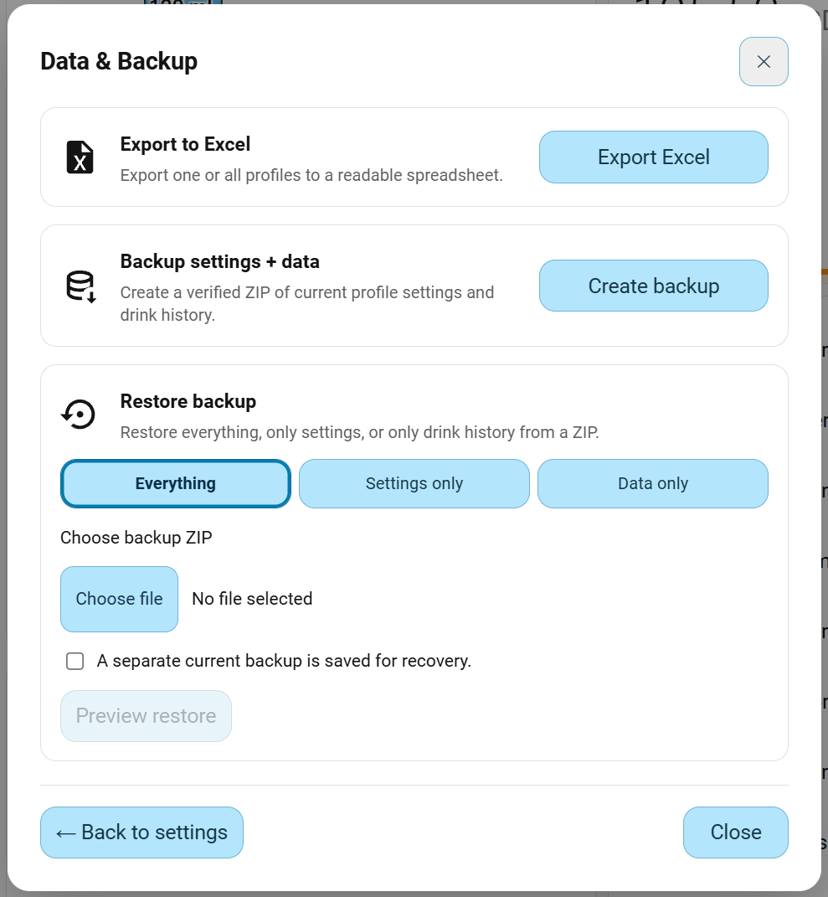</a>

## 8. Upgrading / troubleshooting

HACS installation and updates require a Home Assistant Core restart; then hard-refresh your browser to load the new card. If the card and backend versions differ, complete the restart before changing data.

For safety, keep both a Home Assistant backup and a verified Full Backup ZIP. Never copy or delete Home Assistant storage files to fix a UI problem without a checked rollback plan.

For past releases and historical migration instructions, use [Release notes](RELEASE_NOTES.md) or the [Archive](archive/INDEX.md).
